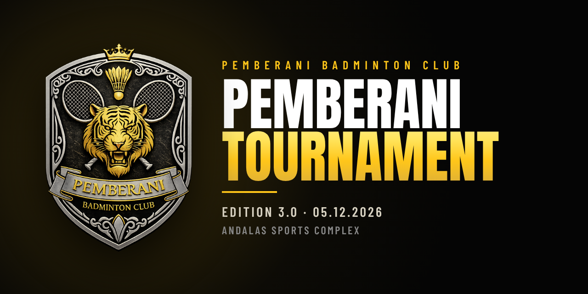

<p align="center"></p>

# Pemberani Tournament · Edition 3.0

Campaign site, live scores, fixtures, standings and bracket for the Pemberani Badminton Club tournament.
Live at **https://pemberanibc.github.io/**. Static site for GitHub Pages, with Firebase Realtime Database for live scoring. No build step and no frameworks:
plain HTML, CSS and JavaScript modules.

**Edition 3.0:** Saturday 5 December 2026 · 10 AM – 5 PM · Andalas Sports Complex · Courts C4 and C5.

Both Edition 3.0 pages have an **EN / BM** switch at the top. The choice is remembered on that phone, and phones set to Malay open in BM.

| Page | Who uses it |
| --- | --- |
| [`/`](https://pemberanibc.github.io/) | Everyone: the Edition 3.0 story (hero, statement, champions, format, players and pots, prizes) with a short "on court now" strip linking to the Match Centre |
| [`/live/`](https://pemberanibc.github.io/live/) | The Match Centre: live courts, latest results, match of the day, fixtures, standings with the qualification race, bracket and pairs. Share this on the day |
| [`/score/`](https://pemberanibc.github.io/score/) | Umpires and committee: tap-to-score console (sign-in required) |
| [`/draw/`](https://pemberanibc.github.io/draw/) | The live group draw, run from a phone. See `draw/README.md` |
| [`/edition2/`](https://pemberanibc.github.io/edition2/) | Edition 2.0 site, kept as an archive |
| [`/edition1/`](https://pemberanibc.github.io/edition1/) | Edition 1.0, the first tournament site, kept as a read-only archive |

Old links (`live.html`, `score.html`, `cert.html`) still work: `404.html` sends them to the new address.

## Files

```
index.html              home page: the Edition 3.0 campaign
404.html                "page not found", and redirects for old links
live/                   Match Centre
score/                  scorer console (sign-in)
draw/                   live group draw (own README)
edition2/               Edition 2.0 archive: its own pages, code, styles and assets
edition1/               Edition 1.0 archive: one page, reads the saved results, never writes
edition2/cert.html      "e-certificates are closed" notice (old cert.html links land here)

css/e3.css              Edition 3.0 styling
css/score.css           scorer console styling
js/config.js            ← dates, pairs, groups, rules, prizes, photos. Edit this one.
js/e3/                  campaign page, Match Centre, animations, EN / BM text
js/logic.js             scoring rules, standings, bracket
js/store.js             Firebase / demo data layer
js/score.js             scorer console behaviour
js/firebase-config.js   Firebase web config (public by design, see Security)
assets/                 crest.png and icon.png (shared by every page)
assets/e3/              Edition 3.0 photos and the link-preview image (og.jpg)

firebase/               recommended database security rules (own README)
tools/draw-film/        source of the group-draw video; not part of the website (own README)
.github/                repository branding: avatar.png and social-preview.png (not published)
```

Everything in this repository is published by GitHub Pages, including `tools/`. Keep anything private out of it.

## Try it without Firebase

- `/?demo` or `/live/?demo`: empty tournament. Scores are kept in this browser only.
- `/?demo=sim`: fills in simulated results (all group matches, quarter-finals, a live semi-final)
  so you can see standings, bracket and scoreboards working. Clear site data to reset.
- Open `/score/?demo` in another tab and score a rally: the other tab updates instantly.

To preview locally, run this from the project folder and open http://localhost:8765/?demo=sim:

```bash
python3 -m http.server 8765
```

## Players and pots

`POTS` in `js/config.js` holds the 24 players. Pot A is the eight past podium finishers, each with
their titles (`[place, edition]`, e.g. `[1, '2.0']` = Edition 2.0 champion); Pot B is everyone else.
The pots are only used to draw the pairs. The tournament groups (A and B, six pairs each) come from the draw.

## Match-day features

- **Phone tab bar** (Live, Fixtures, Table, Bracket, Players) on both pages, plus quick buttons in the hero.
- **Latest results** strip in the Match Centre.
- **Standings:** top four in gold, 5th and 6th dimmed, ▲▼ arrows for 8 seconds when a result changes the order, and any row opens that pair's match history.
- **Qualification race** under each table: wins, losses and matches left for every pair, the current 4th-place line, and
  Qualified / In the race / Eliminated. A pair is only marked qualified or eliminated when it is mathematically certain;
  once the group is finished, the final table (with tiebreaks) decides.
- **Match of the day** and highlight cards (closest finish, biggest comeback, longest match, biggest win), worked out from the
  rally-by-rally scores the scorers enter. Each card shows a different match when there are enough to choose from.
- **Champion announcement** appears automatically at the top of both pages when the final is scored.

## Before the day: what to update in `js/config.js`

1. **The draw.** Done: the live draw on 20 November 2026 is in `GROUPS` and `DRAW_CONFIRMED = true`. Pair numbers
   1–6 follow the order each pair was drawn into its group and decide the order of play (`GROUP_ORDER`). Keep the
   `id`s as they are (`g1p1`…`g1p6` for Group A, `g2p1`…`g2p6` for Group B); scores are stored against them.
2. **Knockout rules.** The captain said "15 points, best of 3". The config assumes win by 2, capped at 21
   (`knockout: { bestOf: 3, target: 15, deuce: true, cap: 21 }`). Change `cap` or `deuce` if the captain decides otherwise.
3. **Prize amounts.** Update the Rewards text in `index.html` (English) and the `pz.cash` line in `js/e3/i18n.js` (BM).
4. **Photos.** Upload them to `assets/e3/` using these names, then list them in `PHOTOS`:

   | File | Where it shows | Best shape |
   | --- | --- | --- |
   | `hero.jpg` | Full-screen opening, behind the title | Landscape, action, subject on the right |
   | `story-1.jpg`, `story-2.jpg`, `story-3.jpg` | Behind "This is not just a game" lines | Landscape or portrait, dramatic |
   | `champions-e2.jpg` | Defending champions (Muizz & Daus) | Portrait (4:5) |
   | `gallery-01.jpg` … `gallery-16.jpg` | Drag-to-scroll gallery (set `GALLERY_COUNT`) | Any |

   Example: `export const PHOTOS = ['hero', 'champions-e2'];` and `export const GALLERY_COUNT = 9;`
   Phone photos are fine. Keep each under about 500 KB (long side about 2000 px). The site greys and darkens them to fit the look.

## Firebase

Edition 3.0 stores scores and the live draw under `/pt3`; Edition 2.0 results under `/pt2` stay untouched.
The database rules this site needs are in [`firebase/database.rules.json`](firebase/database.rules.json), with
instructions in [`firebase/README.md`](firebase/README.md). They are applied in the Firebase console, not from GitHub.
Scorer accounts and the `admins` list from Edition 2.0 keep working.

If Firebase can't be reached, the pages fall back to demo mode and show a yellow "Demo" badge, so a broken connection is visible.

## On the day

- **Share https://pemberanibc.github.io/live/** in the WhatsApp group. It loads fast and goes straight to the scores.
- **Umpires** open https://pemberanibc.github.io/score/, sign in, and pick their court (**C4 · Group A** or **C5 · Group B**). Tap **Start**,
  choose who serves, then tap a team's panel for every rally. Groups stop at 21; knockouts are best of three to 15.
  **Undo** reverses the last rally, even after a match has ended.
- **Knockouts fill themselves** once both groups are done (top 4 cross over: A1 v B4, B2 v A3, B1 v A4, A2 v B3).
  For a tie that needs a committee decision, use **Committee tools → Knockout draw overrides**.
- **Wrong result?** **Committee tools → Correct a result** resets a match so it can be rescored.

## Design notes

- Scroll animations use CSS `position: sticky` and one small scroll handler, with no animation library, so it stays smooth on cheaper phones.
- Visitors with "Reduce Motion" switched on get gentle fades instead of movement, and the statement lines are shown one after another.
- Any new text needs a BM version: add a `data-i18n` key in the HTML and the translation in `js/e3/i18n.js`.

## E-certificates

Closed until after Edition 3.0. `edition2/cert.html` (and the old `cert.html` link) shows a notice saying Edition 3.0
certificates open after the tournament. The Edition 2.0 generator (page, script, PDF library, certificate backgrounds,
script font) is in the git history: restore it with

```bash
git checkout 1b1eb86 -- edition2/cert.html edition2/js/cert.js edition2/js/vendor edition2/assets/cert edition2/assets/fonts
```

and use it as the starting point for the Edition 3.0 certificates (new backgrounds, pairs and kinds), then reopen
writes to `certLog` in the Firebase rules (see `firebase/README.md`).

## Security

The site is public and has no server of its own, so its safety rests on the Firebase settings. Checklist:

- **Database rules.** Publish the rules in `firebase/` (see its README). Public visitors can read scores; only admins
  can change them; the certificate log only accepts well-formed new entries; the old family-night scores are closed.
- **Firebase web config is not a secret.** `js/firebase-config.js` has to be in the page for the site to work. Access
  is controlled by the rules above. To stop the key being reused elsewhere, restrict it in
  [Google Cloud → APIs & Services → Credentials](https://console.cloud.google.com/apis/credentials?project=pemberani-badminton):
  *Website restrictions* → `pemberanibc.github.io/*` (add `localhost` while testing).
- **Scorer accounts.** In Firebase → **Authentication → Settings**: turn off *User actions → Enable create (sign-up)*
  so nobody can make their own account (the committee adds scorers under **Users**), keep *Email enumeration protection*
  on, and remove unused entries under *Authorized domains*. Delete scorer accounts nobody uses any more, and remove
  their uid from `admins`.
- **GitHub.** Turn on two-factor authentication for every account with write access. In the repository settings:
  *Pages → Enforce HTTPS*; *Code security → Secret scanning* and *Push protection*; and a branch rule on `main`
  that requires a pull request, so nothing reaches the live site by accident.
- **Never commit** passwords, admin emails, phone numbers or private photos: everything here is public, and removing a
  file later does not remove it from the git history.

